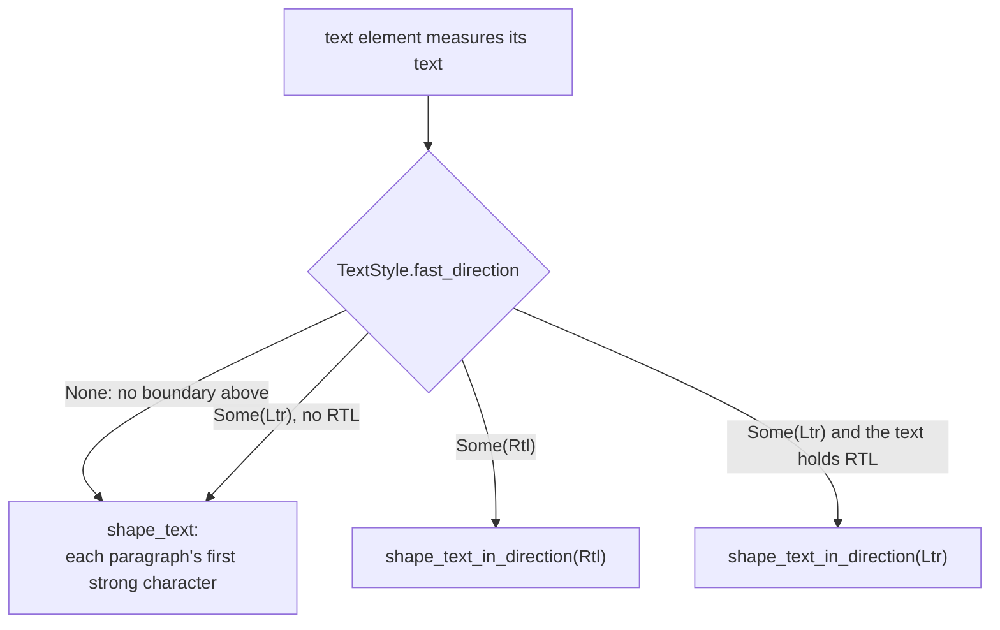

# Text below no direction boundary takes its first-strong base

**Date:** 2026-10-21
**Status:** Accepted
**Area:** `crates/gpui/src/fast/` (direction, text measurement)

## Context

Holool's RTL support adds an inherited `LayoutDirection` (see
[`holool-rtl.md`](../holool-rtl.md)). The direction is one value, used for
two jobs:

- **Layout.** Taffy 0.14 mirrors flex and block layout under `Rtl`.
- **Text.** The text element shapes any text that holds an RTL character
  with `shape_text_in_direction(.., text_style.fast_direction)`. The
  direction is the paragraph base.

`TextStyle.fast_direction` was a plain `LayoutDirection` that defaults to
`Ltr`. So "no element set a direction" and "an element set `.ltr()`" were
the same value. In both cases, Arabic text was shaped on a left-to-right
base, and `shape_line_in_direction` put a U+200E LEFT-TO-RIGHT MARK in front
of every row.

Applications that mirror their layout by hand, and so keep layout left to
right, could not get a right-to-left base for Arabic text. Neutral
characters at the edges of an Arabic line were drawn on the wrong side:

| Text | Shown | Expected |
|---|---|---|
| `تتلقى الصناديق القائمة الجديدة فور النشر.` | full stop at the right | full stop at the left |
| `تجاهل الكل…` | ellipsis at the right | ellipsis at the left |
| `3 ضيوف` (leading number) | number at the left | number at the right |

A mark in the string cannot fix this. A leading U+200F RIGHT-TO-LEFT MARK
comes after the LRM that `shape_line_in_direction` inserts, so the base
stays left to right. An RLI…PDI isolate fixes only the first row, because
each wrapped row is shaped on its own. Marks in the strings also reach
editable values and exported data.

`.rtl()` on the text's element fixes the text, but it also mirrors that
element's layout. An application that mirrors by hand would then flip its
rows twice.

Upstream GPUI and this fork's plain `shape_text` already shape each
paragraph by its first strong character (`shape_text_auto`). Only the text
element forced the inherited direction.

## Decision

The direction is unset until a boundary sets it.

- `TextStyle.fast_direction` is `Option<LayoutDirection>`. `None` means no
  ancestor set a direction. `.direction()`, `.rtl()` and `.ltr()` set
  `Some`, as before.
- `fast::text::measure_text` shapes text with no direction through
  `shape_text`, which takes each paragraph's first strong character. An
  explicit boundary still forces its base, so `.ltr()` around source code
  keeps a left-to-right base.
- `Window::layout_direction()` keeps its signature. It answers `Ltr` when
  no direction is set. Layout, logical edges and Taffy are unchanged:
  unset still lays out left to right. `fast::direction::inherit_style` still
  writes the inherited direction into the style it hands to Taffy; children
  take their text style from each element's own refinement, so that write
  does not reach text.

## Consequences

- Text with no boundary above it now follows the Unicode Bidirectional
  Algorithm's default paragraph rules (P2, P3), as upstream GPUI does. Arabic
  text in a left-to-right layout gets a right-to-left base. Mixed text whose
  first strong character is Latin stays left to right.
- Alignment does not change. `text_align` stays physical; an application
  that wants Arabic text at the right still sets `TextAlign::Right` or a
  boundary.
- **API.** The type of `TextStyle.fast_direction` changes from
  `LayoutDirection` to `Option<LayoutDirection>`. No new item is added. Code
  that reads the window's direction keeps calling `Window::layout_direction()`.
  Code that writes the field writes `Some(direction)`. GPUI Kit reads only
  `StyleRefinement.text.fast_direction` (already an `Option`) and
  `Window::layout_direction()`, so it compiles unchanged.
- Editors that shape with `Window::layout_direction()` explicitly, such as
  GPUI Kit's input, keep a left-to-right base under no boundary. That is
  their own choice and is not changed here.

## Verification

`fast::tests::bidi::text_under_no_direction_boundary_takes_its_first_strong_base`
draws six probes in one window and reads the caret at every character
boundary:

- Arabic under `.ltr()` and under `.rtl()` lay out differently (the probe can
  tell the two bases apart).
- Arabic under no boundary lays out exactly as under `.rtl()`.
- Arabic under a parent with logical padding (`ps`) does the same.
- Latin under no boundary lays out exactly as under `.ltr()`.

The test compares carets, not glyph pixels: the test platform's shaper
places glyphs in logical order, but the caret geometry still follows the
paragraph base. Reverting the change in `measure_text` fails the test on
"Arabic under no boundary takes a right-to-left base, as under .rtl(): its
full stop goes to the left".

A GPUI Kit application (GPUI Kit `4d4f999`, with every gpui-fast crate patched
to this change) builds without source changes. In its Arabic screens, which
mirror layout by hand under no boundary, the full stop of a dialog subtitle
and the ellipsis of "تجاهل الكل…" move to the left, and a toast that starts
with a quoted name reads in the right order.
